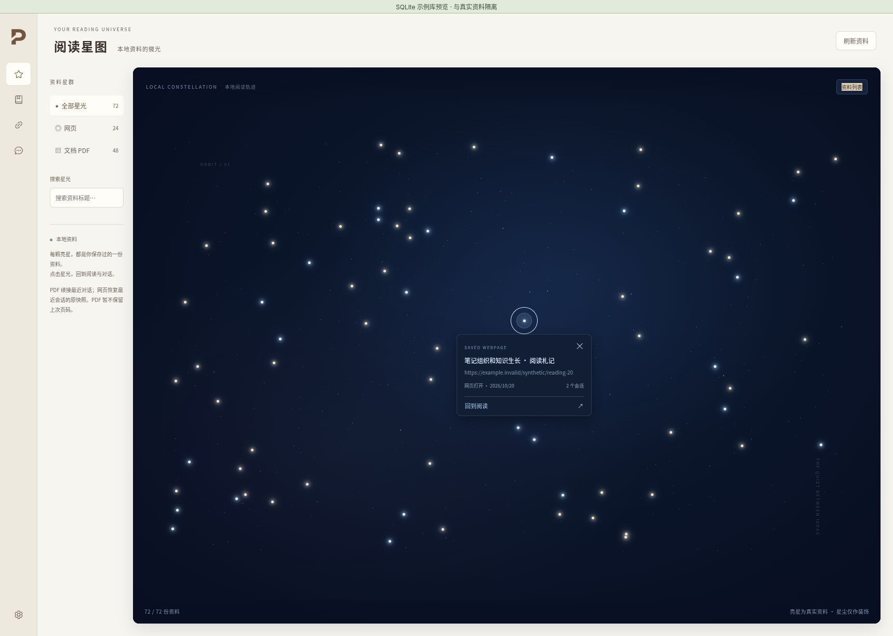

# PaperMind 阅读星图设计

阅读星图将本地保存的 PDF 和网页组织为密集星空，用于浏览资料并回到对应的阅读历史。

- 新增“阅读星图”入口；左侧切换全部、网页、PDF，中央为深蓝星空、资料亮星、低对比装饰星尘。保留搜索与点击续读；默认不显示资料名称，鼠标停留或键盘聚焦星点时才显示紧邻星点下方的紧凑预览，移出后收起。预览贴近窗口边缘时避让，保持可读；不再固定在左下角。
- 每份本地已保存资料对应一个星点。通过现有 window.db IPC 读取 SQLite 元数据，不复制数据库、不改 schema、不发模型请求。不为了视觉密度伪造本地资料。
- PDF 点击进入现有 Reader，并选中与该论文相关、最近有消息的会话；没有会话时保持 Reader 原行为。网页点击恢复最近会话及其原快照；没有会话时打开最新保存快照。已有记录被删除时给出可恢复提示。
- PDF 当前没有持久化上次滚动位置，本阶段不承诺精确恢复页码。时间字段按真实含义标注：加入时间、最近提问或网页打开时间。
- 使用稳定 ID 布局，筛选/搜索不让剩余资料跳位；装饰星尘不响应鼠标。大量记录允许滚动/缩放等最小必要导航，不能静默截断。
- 星图不绘制语义连线，也不内置示例资料。此阶段是本地资料导航，不包含知识抽取；语义关联留待后续设计。
- 保持现有 PaperMind 暖色框架；响应式布局、焦点可见、空状态、加载与错误重试均可用。

## Approaches

采用密集、非规则星点布局，沿用 Vue/TypeScript 和现有 IPC，无需引入图数据库、图谱框架或新的解析链路。展示组件、数据映射和阅读历史恢复分别组织。

验收：真实网页/PDF均能列出、搜索与筛选；实际会话与其来源一致；删除/缺失/失败状态明确；返回后筛选尽量保留；类型检查、现有测试与针对历史恢复的回归测试通过。

## 已验证结果与限制

类型检查通过；Vitest 167 个文件、2091 项测试通过，另有 24 项品牌与运行时检查通过。使用独立 SQLite 示例库验证了 48 份 PDF、24 个网页的筛选、列表、阅读历史恢复与星点预览；示例库不随应用交付。

当前布局按资料 ID 稳定分布，尚无避碰排布，邻近星点可通过搜索或资料列表访问；PDF 暂不恢复上次页码，尚无语义关系连线。

