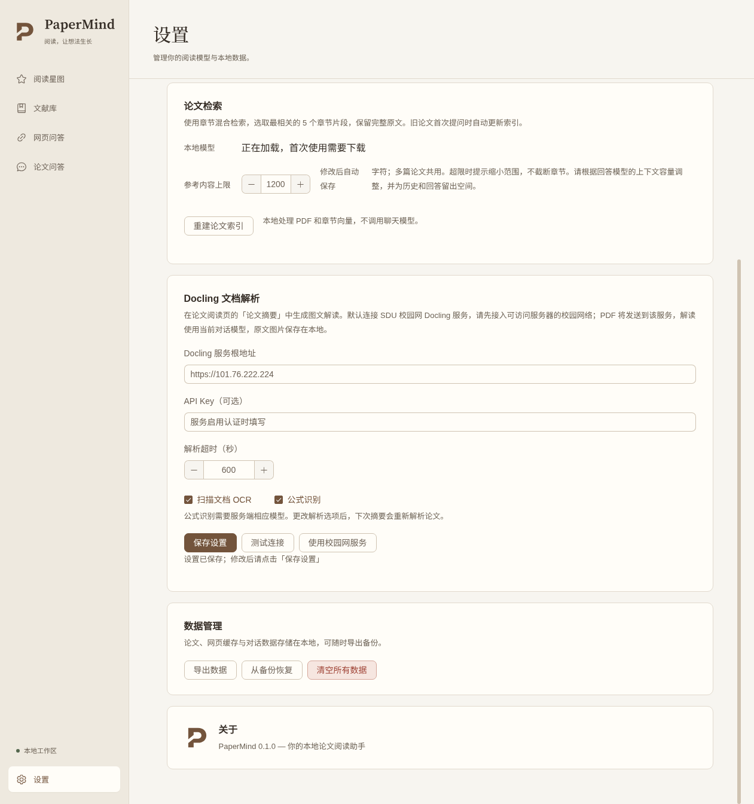

# 校园网 Docling HTTPS 接入与维护

## 用户使用

新配置默认使用 `https://101.76.222.224`。连接能够访问该服务器的 SDU 网络，在设置页测试 Docling 连接后即可上传 PDF；不需要 SSH、服务器账号或系统证书安装。校园网入口当前不要求 API Key。

升级不会静默覆盖用户保存的本地或自建地址。旧用户进入「设置 → Docling 文档解析」，点击「使用校园网服务」，再点击「保存设置」和「测试连接」。该按钮清除原服务的 API Key，避免把自建服务凭据发送给校园网入口；OCR、公式和超时选项保持不变。显式配置 localhost 仍访问本机，应用不再自动创建 SSH 隧道。

浏览器或普通 curl 直接访问该 HTTPS 地址会提示不信任证书，这是专用 CA 的预期行为。PaperMind 主进程只对该固定 HTTPS origin 使用随程序打包的公开 CA，依然验证证书链、IP 和有效期；不会修改操作系统证书，也不会跳过验证。其他 HTTPS 地址使用原有系统信任。不要使用 `curl -k`、全局关闭 TLS 或安装服务器私钥来解决连接问题。

PDF 上传到服务器进行 Docling 解析；摘要仍由当前配置的大模型生成，用户仍需配置可用模型。网页摘要继续走 HTML 解析。



截图使用同版 Electron 测试启动器加载实际 Linux app.asar，数据来自隔离的新用户目录。

## 部署结构与配置

```text
PaperMind --HTTPS--> 101.76.222.224:443 (Nginx)
                          |
                          +--HTTP--> 127.0.0.1:5001 (Docling)
```

- Nginx 配置源：`deploy/docling/nginx.conf`；服务器 `/etc/nginx/sites-available/papermind-docling`，链接到 `sites-enabled`。
- 仅监听目标 IPv4 的 443，未开放默认 HTTP 80 站点；内部 Docling 继续只监听回环地址。
- 仅允许 `GET /health`、`GET /openapi.json`、`POST /v1/convert/file`（GET 隐含允许 HEAD）；其他路径 404，转换接口其他方法 403。
- 最大 multipart 请求 65 MiB，允许客户端 64 MiB PDF 加上字段；代理连接超时 5 秒，发送/读取空闲超时 1900 秒。客户端总超时仍为 30–1800 秒，默认 600。
- 文件转换入口全客户端最多 2 个正在处理的 HTTP 请求，超过返回 429，不提供持久队列。断开请求不保证 Docling 已停止底层 GPU 工作，此限制不等同于严格的后台作业配额。
- 请求和响应代理缓冲关闭，不把上传 PDF 正文写入 Nginx 临时文件。访问日志记录 IP、路径、状态与响应大小等标准信息，不记录文档正文、API Key 或摘要。
- 当前服务器 UFW 未启用，本次未启用整机防火墙或改动 SSH。监听校园网可达 IP 本身不能证明校外不可达；如果需要严格的校内访问限制，须取得学校确认的来源网段/网络边界规则后再设置，不能猜测 CIDR。
- 用户级 `papermind-docling.service` 保持 enabled，已启用 `loginctl enable-linger ubuntu`；Nginx 是 enabled 的系统服务，并通过 systemd drop-in 等待 network-online、失败后每 5 秒重启，避免开机时目标 IP 尚未分配导致入口一直离线。本次不重启整机验证启动流程。

服务器初次安装 Nginx 时，原 SDU apt 镜像连接失败。本次仅用 `/tmp/papermind-apt-sources.list` 指定清华 Ubuntu 镜像完成更新与安装，没有替换机器的永久软件源配置。

## 证书与更新

公开根证书唯一源码为 `electron/certificates/docling-campus-ca.json`；Vite 将它嵌入主进程包，不依赖开发目录或额外资源路径。信任限定在 `https://101.76.222.224`，不传给其他服务，不允许跟随重定向。

- 根证书 SHA-256：`B7:25:E9:65:93:4E:BB:24:C5:2F:12:E8:0D:53:B5:48:CE:15:15:42:B6:24:B1:1C:72:74:7A:2B:11:A1:F6:E1`。
- 根证书有效至 2036-10-29；叶证书有效至 **2028-10-31 13:10:06 UTC**。需在叶证书过期前续签并重新加载 Nginx。
- 根 CA 私钥只保存在管理员本机 `/home/xmdjy/.local/share/papermind/docling-campus-pki/root-ca.key`；目录 0700、文件 0600。应另行安全备份。根私钥未上传服务器，不在仓库和安装包内。
- 服务器叶私钥 `/etc/papermind/docling/server.key` 为 root:root 0600，其父目录 0700。部署暂存目录中的私钥副本已删除。
- 叶证书、公开根证书分别为 `/etc/papermind/docling/server.pem`、`root-ca.pem`。私钥仅供 Nginx 使用，用户不需要它。

证书更新时，在管理员本机原 PKI 目录生成新的叶证书私钥与 CSR，保留 IP SAN `101.76.222.224`、用途 serverAuth；使用原根 CA 签名后，仅上传新叶证书与叶私钥。根 CA 不变时，用户无需更新应用。可执行以下命令签署已经生成好的 CSR（不可使用缺少 SAN 的默认 CSR）：

```bash
openssl x509 -req -in server.csr -CA root-ca.pem -CAkey root-ca.key \
  -CAcreateserial -days 730 -sha256 -extfile server.ext -out server.pem
openssl verify -CAfile root-ca.pem -verify_ip 101.76.222.224 server.pem
```

现有 `server.ext` 包含 IP SAN、非 CA 约束、serverAuth 和密钥用途。上传时不要上传 `root-ca.key`。通过 `deploy/docling/install-nginx.sh SERVER_CERT SERVER_KEY ROOT_CA_CERT` 安装（root 执行、需已安装 Nginx）；脚本先验证证书、IP 与密钥匹配，备份旧配置、证书，执行 `nginx -t` 后启用服务。脚本只适用于当前专用服务器，会移除默认站点并启用 ubuntu linger；不要直接在共用网站服务器运行。

服务器 IP 变化需要重新确定网络入口、签发匹配新 IP 的证书并更新客户端的地址与信任范围。更换根 CA 需要先发布包含新根证书的客户端，再切换服务证书。

## 运维和回退

```bash
sudo nginx -t
sudo systemctl status nginx
systemctl --user status papermind-docling.service
loginctl show-user ubuntu -p Linger
sudo tail -50 /var/log/nginx/papermind-docling-error.log
```

初次部署备份为 `/root/papermind-nginx-backup-IQrc10pN`。回退入口时删除 `/etc/nginx/sites-enabled/papermind-docling`，恢复备份中的原配置链接，执行 `nginx -t` 后重载 Nginx。Docling 内部监听不变；旧版本需要时仍可由管理员手动建立 SSH 转发，但本版客户端不会自动启动隧道。不要回退数据库或覆盖用户文档。

## 验证记录与边界（2026-11-01）

部署后从本机直接 HTTPS 访问 `/health` 返回 `{"status":"ok"}`；生产客户端连接检查确认文件转换接口存在。未使用本地 5001 转发，无需用户 SSH 登录。普通 curl 不指定专用 CA 时拒绝证书，指定 CA 时成功；`/docs` 返回 404。退出服务器管理会话后入口持续可用。

自动测试、真实 PDF 任务与构建结果见下方最终记录。用户后续需要在不同电脑、宿舍/实验室/不同校区网络测试；本机可达不代表全校所有网段均已放通。

Electron 实际 HTTPS 联调发现，带 IP nameConstraints 的 CA 在普通 Node/OpenSSL 下可用，但 Electron 的 TLS 实现拒绝该扩展。已用实际 Electron 44.10.1 重现并验证：采用不含该不兼容扩展的专用 CA，保持应用内固定 origin 信任及叶证书 IP 校验后连接成功。根私钥和叶私钥未改变，公钥 CA 源码与服务器公开根证书已同步。后续维护不得只用系统 Node/curl 代替 Electron 运行时验证。

原 Electron 44.9.3 / Node 24.22.0 未通过现有安全门禁。隔离 npm 缓存并强制在线查询后已取得 44.10.1（初始 E404 来自旧缓存），独立下载的实际二进制确认为 Electron 44.10.1 / Node 24.22.1，与 [官方发布记录](https://releases.electronjs.org/release/v44.10.1) 一致。已将项目依赖与锁文件升级到该补丁版本，在运行时策略中登记这对实际版本和官方证据；旧运行时仍被拒绝，安全下限未降低。

### 最终结果

| 检查 | 结果 |
| --- | --- |
| `npm test` | 174 个 Vitest 文件、2224 项测试；另 24 项脚本测试，全通过 |
| `npm run typecheck` | 通过 |
| `npm run security:runtime` | 正式安装的 Electron 44.10.1 / Node 24.22.1 通过 |
| `npm run build -- --dir --publish never` | Linux x64 目录打包通过；afterPack 核验包内实际运行时并生成证明，未发布安装包 |
| Electron 页面 → preload → IPC → 真实 HTTPS | 连接成功，使用隔离用户目录；没有使用 SSH 隧道 |
| Linux `app.asar` 产物 → 页面 → preload → IPC → HTTPS | 使用同版 Electron 测试启动器加载实际 asar，连接成功；设置页默认地址和校园网按钮正确 |
| 服务入口限制 | `/docs` 404；GET 转换接口 403；超限 Content-Length 请求 413；两个未完成上传占满入口后第三个请求 429，未额外启动 PDF 解析 |
| 证书校验 | 未指定 CA 的 curl 拒绝；应用专用 CA 成功；自动测试覆盖错误签发者、IP 不匹配、信任不扩散到其他 origin、重定向不转发凭据、取消上传与响应 |

真实输入为 53 页 `2412.19437v1.pdf`。通过 HTTPS 上传后约 **203.21 秒**得到 1167 项材料（图片 15、标题 69、正文 1041、表格 12、公式 30），15 张可用图片，无解析警告。实际调用当前配置的 deepseek-flash 生成中文摘要，总耗时 **447.58 秒**，正文 **12172 字符**，引用 7 张原图，未截断。

真实 SQLite 保存后内容一致，重建 store/解析器后重新加载与缓存复用通过，复用时新增网络请求为 0；外键检查为空，摘要备份校验通过。生产 Markdown 渲染器检查到 52 处公式、7 张图片、3 个表格，公式错误和残留粗体标记均为 0。

真实完整摘要链路使用修复后的独立 Node 24.22.1，未通过 Electron UI 再次发起完整收费摘要。Electron 额外验证了实际嵌入式 TLS、应用 IPC 和实际 asar 产物的连接。Windows/macOS 安装、不同校园网网段以及重启整机后的启动流程仍需进一步实机测试；本次没有生成或发布 EXE/DMG。

本机测试成果目录：
`/home/xmdjy/.codex/visualizations/2026/10/23/01a168f0-f5bf-74b1-8cbe-6811be93e092/papermind-campus-https-live-20261101-2026-11-01T13-12-59-693Z/`。
原用户数据库只读使用，成果写入隔离 SQLite；未改写原设置、PDF 或网页数据。测试文件、数据库和生成包未放入 Git。
